

<picture><source media="(prefers-color-scheme: dark)" srcset="assets/hero-dark.svg"></picture>

<picture><source media="(prefers-color-scheme: dark)" srcset="assets/social-l-dark.svg"></picture><a href="https://t.me/"><picture><source media="(prefers-color-scheme: dark)" srcset="assets/social-1-dark.svg"></picture></a><a href="https://discord.com/"><picture><source media="(prefers-color-scheme: dark)" srcset="assets/social-2-dark.svg"></picture></a><a href="https://x.com/"><picture><source media="(prefers-color-scheme: dark)" srcset="assets/social-3-dark.svg"></picture></a><picture><source media="(prefers-color-scheme: dark)" srcset="assets/social-r-dark.svg"></picture>

<picture><source media="(prefers-color-scheme: dark)" srcset="assets/about-dark.svg"></picture>

<picture><source media="(prefers-color-scheme: dark)" srcset="assets/stack-dark.svg"></picture>

<a href="https://github.com/ZxverOwner/zxverowner.github.io"><picture><source media="(prefers-color-scheme: dark)" srcset="assets/project-zxverowner-github-io-dark.svg"></picture></a>&nbsp;<a href="https://github.com/ZxverOwner/ZxverOwner"><picture><source media="(prefers-color-scheme: dark)" srcset="assets/project-zxverowner-dark.svg"></picture></a>

<a href="https://github.com/ZxverOwner/badrepo.github.io"><picture><source media="(prefers-color-scheme: dark)" srcset="assets/project-badrepo-github-io-dark.svg"></picture></a>&nbsp;<a href="https://github.com/ZxverOwner/FNFViin"><picture><source media="(prefers-color-scheme: dark)" srcset="assets/project-fnfviin-dark.svg"></picture></a>

<picture><source media="(prefers-color-scheme: dark)" srcset="assets/stats-dark.svg"></picture>

<picture><source media="(prefers-color-scheme: dark)" srcset="assets/streak-dark.svg"></picture>

<picture><source media="(prefers-color-scheme: dark)" srcset="assets/wave-dark.svg"></picture>

<a href="https://zxd.lol"><picture><source media="(prefers-color-scheme: dark)" srcset="assets/button-1-dark.svg"></picture></a>&nbsp;&nbsp;<a href="https://github.com/ZxverOwner?tab=repositories"><picture><source media="(prefers-color-scheme: dark)" srcset="assets/button-2-dark.svg"></picture></a>

<a href="https://metawka.github.io/expressive-profile/?from=ZxverOwner"><picture><source media="(prefers-color-scheme: dark)" srcset="assets/credit-dark.svg"></picture></a>

